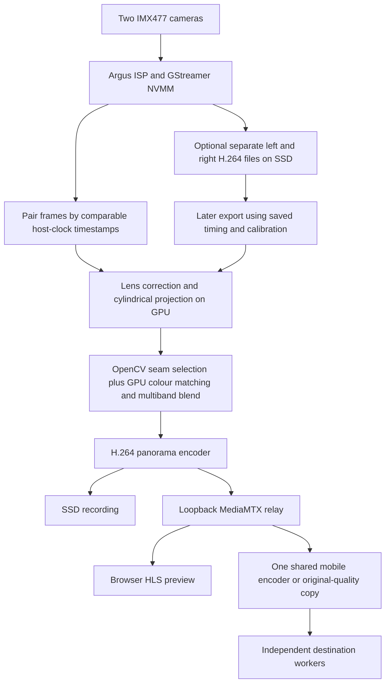

# Reco Field

Reco Field turns a compatible dual-camera Jetson into a local sports-camera
appliance. It starts its web interface at boot and provides panorama preview,
recording, multiple streaming destinations, camera controls, lens measurement,
rig alignment and recording downloads from a phone or computer.

It builds on the Rust and wgpu engine in
[Reco Video Stitcher](https://github.com/reco-project/video-stitcher). The work
described here adds the appliance and changes the capture, stitching and media
paths needed by the tested Jetson. This is the public implementation record as
of **31 October 2026**. See the [change record](RECO-FIELD-CHANGELOG.md) for the
individual additions, fixes and configuration changes, and the
[installation and operating guide](../appliance/README.md) for release commands.

## Tested hardware and software

| Component | Validated configuration |
| --- | --- |
| Computer | Jetson Orin Nano Super developer kit, 8 GB |
| System | JetPack 6.2.3, L4T 36.5.2, Ubuntu 22.04, ARM64 |
| Cameras | Two IMX477 CSI cameras through NVIDIA Argus |
| Sensor capture | Mode 0, 4032 × 3040 at a requested 30 fps |
| Storage | 1 TB NVMe SSD, ext4, mounted at `/srv/reco-ssd` |
| Live panorama | Cylindrical 3072 × 864, H.264 through software libx264 |
| Original-camera files | Two independent 2016 × 1520 H.264 files |
| Native engine | Reco 0.5.4 with the changes in this tree |
| Image and media tools | OpenCV 4.8, Vulkan/wgpu, GStreamer, FFmpeg 4.4, MediaMTX 1.21.3 |
| Web service | Python 3.10, FastAPI, Uvicorn, bundled HTML/CSS/JavaScript |

The Orin Nano has no NVENC hardware encoder. The GPU performs image processing;
H.264 encoding consumes CPU time. These results do not establish compatibility
with older Jetson Nano devices, other JetPack releases, other camera drivers or
different sensor crops. Camera drivers and the NVIDIA software stack must work
before installing the appliance.

The prototype's exact lenses have not yet been physically measured. A nominal
wide-angle specification is not a measurement of horizontal coverage on these
sensors. The installed lens profiles remain nominal until the printed-target
workflow is completed.

## What the operator can do

- **Live:** start a genuine preview without saving a recording, choose Panorama
  or Original cameras, record, stop and see capture state, temperature, CPU,
  memory, SSD space and bytes written.
- **Recordings:** download completed panoramas or the two original-camera files;
  create a panorama later from a source session; monitor or cancel that export.
- **Setup → Cameras:** select supported sensor/capture settings, output geometry,
  exposure range, analog gain, ISP digital gain, white-balance mode and lock.
- **Setup → Alignment:** inspect separate camera views, import lens profiles,
  measure each lens with a printed board and run geometric rig calibration.
- **Streaming:** configure YouTube, Facebook, Twitch or custom ingest details,
  choose a mobile or original-quality stream, and enable several destinations.
- **Setup → Network:** connect to a router or phone hotspot, show or save the
  camera Wi-Fi QR code, and change the camera network's name and password.

The interface has Live, Recordings and Setup navigation, light and dark
appearance, keyboard focus, labeled fields and touch controls of at least
44 CSS pixels. The panorama keeps its real aspect ratio on a phone. There is no
frontend build step, runtime CDN, external font or cloud account requirement;
the HLS player and its license are bundled.

Booting starts the services, not a public broadcast. Automatic recording and
streaming are explicit settings and are off in the validated configuration.
Camera settings, network changes and calibration are blocked while conflicting
camera work is active. The app distinguishes starting, previewing, recording,
finishing, idle and failure rather than equating a running process with valid
camera output. Development simulation is explicit and labeled.

### Network access and permissions

The login screen was removed at the operator's request. Any device able to reach
the web interface can control the appliance. Browser sessions, same-origin
checks and CSRF protection remain, but they do not restrict other users of that
network. Use a trusted LAN or private hotspot; do not expose the control port
directly to the internet.

The application runs as a dedicated unprivileged `recofield` user. A separate,
restricted helper performs NetworkManager changes through a local Unix socket.
Stream keys and Wi-Fi profiles are stored privately. Routine stream settings
mask keys, and logs omit credentials. The Camera Wi-Fi card deliberately makes
its join details available; QR images contain those credentials, so a saved or
printed QR grants access to that network.

## How the pipeline works



The three boot services are `reco-field`, `reco-field-relay` and
`reco-field-network`. The web service supervises exclusive camera operations,
validated settings and subprocess lifecycles. MediaMTX supplies local preview
and forwarding. Its RTMP, HLS and API listeners remain on loopback; the web app
proxies preview to the browser. The network helper is isolated from the camera
and media processes.

The deployed ports are 8081 for the web interface and loopback ports 1936,
8887 and 9998 for the relay. They allow the web services to coexist with another
camera application. Physical cameras and NVIDIA Argus are still shared:
another application must release them before Reco Field captures, and restarting
Argus interrupts every application using it.

### Geometry, seam and colour

The panorama uses a cylindrical projection fitted to valid calibrated coverage;
a perspective camera crop remains available. Framing removes uncovered lens
boundaries instead of blending them into a dark notch. Pixels seen by only one
camera keep their full brightness.

OpenCV chooses a colour-based graph-cut seam from reduced, aligned views. Work
runs in a bounded background worker. A candidate must preserve coverage and
pass a disagreement check; otherwise the geometric blend remains in use. An
accepted seam stays fixed until geometry changes, which avoids a seam moving
around on every frame. Full-resolution video continues through the GPU.

The GPU compares corresponding overlap pixels, compensates exposure and colour,
and blends fine detail and broad illumination at different scales. Seam-mask
pyramids and warp views are cached and invalidated when their inputs change.

The native capture path now follows each sensor's reported NVMM colour matrix
and range. Both tested sensors provide BT.601 limited-range NV12; the panorama
is converted and tagged BT.709 limited range. Separate-camera files preserve
the BT.601 input metadata. White balance must be allowed to settle before it is
locked. Limiting digital gain prevents extra amplification; it cannot recover
detail lost to darkness, poor focus or sensor noise.

Frame pairing uses comparable GStreamer host-clock timestamps and replaces an
older frame when the difference exceeds half a frame plus 2 ms: about 18.67 ms
at 30 fps. This replaces FIFO pairing that previously allowed stale pairs
70–138 ms apart. It is **software pairing, not synchronized sensor exposure**.
Missing comparable timestamps are reported rather than silently declared
synchronized.

### Calibration is two separate jobs

**Lens measurement** estimates each camera's optics. The downloadable target
is a 7 × 5 ChArUco board using `DICT_4X4_50`, with 30 mm squares and 22 mm markers.
Print it at 100% scale on A4 landscape, verify the square size and mount it flat.
Collect 16–32 stationary views per lens at varied positions, distances and
angles, including the image edges. The OpenCV fisheye/KB4 fit uses held-out
observations to check accuracy. Poor detections, insufficient variety and bad
fits are rejected. Applying a validated profile backs up existing data and
invalidates old rig alignment.

**Geometric alignment** estimates how the cameras are mounted relative to each
other. It needs a stationary rig, useful overlap and a detailed scene. An
unsuccessful or cancelled attempt preserves the previous valid calibration.
Measured lens profiles are tied to the sensor ID, mode and capture dimensions;
changing the sensor crop requires an appropriate profile and fresh alignment.

The measurement workflow has been tested, including real full-resolution setup
captures and rejection when no board is visible. Physical board measurement is
still deferred. A graph-cut seam cannot remove close-range parallax, fix lens
focus, create missing optical coverage or correct unsynchronized exposures.

## Recording, export and streaming

**Panorama** saves the stitched image directly. **Original cameras** saves a
separate file from each camera, retaining the full sensor field of view at the
configured encoded size. These are ISP-processed H.264 images, not raw sensor
data. Original-camera mode also produces a stitched viewfinder and optional
outbound stream at up to 10 fps. The preview rate is independent of the source
encoders. Preview-only operation does not create a hidden recording.

Each source session records timing anchors, packet information, colour metadata
and copies of the calibration and lens profiles used for that session. A later
export uses this saved state. It aligns the files over their common time
interval and resamples by software timestamps, reporting repeated and skipped
frames. It tolerates equal timestamps caused by millisecond container precision,
rejects backwards timestamps and rejects excessive timing gaps. It does not
pretend the sources were hardware synchronized.

Offline export runs while capture is idle, uses CPU decoding and GPU stitching,
and preserves the originals. The app selects x264 `veryfast`, CRF 17.6 and four
encoder threads. Progress and cancellation remain visible; incomplete output
cannot be downloaded as a completed panorama. Safe path checks, session
validation and recurring SSD checks also apply to export.

Streaming accepts RTMP, RTMPS and SRT ingest URLs. Each destination has its own
worker and retry state. Mobile mode makes **one shared 6 Mbps rendition**, then
copies it to each destination. Original quality skips that extra encoder.
Mobile panorama output targets up to 1920 × 540; source-mode streaming uses its
1536 × 432, 10 fps viewfinder. Available upload must cover all enabled
destinations plus audio and protocol overhead.

Silent AAC is included for compatibility. Microphone capture is not configured.
Platform presets do not create a broadcast, provision stream keys or provide
platform OAuth. Local relay forwarding has been verified; acceptance by public
platforms and real phone-hotspot upload have not.

A failed destination does not stop local recording. Native relay output has
bounded connection/write deadlines; a live relay-stall test confirmed that the
local file kept growing and finalized successfully. If the native publisher
disables itself after a relay failure, its preview returns on the next capture
session; automatic recovery of that publisher within the same session is not
claimed.

## SSD storage and appliance operation

The validated device mounts its SSD at boot and checks the configured filesystem
UUID before starting the application and relay. Recordings, setup snapshots,
temporary media, HLS segments and bounded application logs live beneath
`/srv/reco-ssd/reco-field`. A missing or different SSD fails closed. It never
falls back to saving video on the microSD card. A mount-namespace test hid the
SSD and confirmed refusal without creating fallback storage.

The prototype SSD was formatted and configured once with the operator's explicit
authorization. That is a per-unit storage operation, not permission to format
every disk found by an installer. New units need their own mounted SSD, recorded
UUID, settings and calibration. Distribution packages must not contain another
unit's credentials, NetworkManager profiles, recordings or measured calibration.

Headless operation sets `multi-user.target` as the default and stops GDM. The
desktop remains installed for recovery:

```sh
sudo systemctl set-default graphical.target
sudo systemctl start gdm
```

Return to appliance boot with `sudo systemctl set-default multi-user.target`.
Stopping GDM ends any current desktop session. **No OS packages were purged.**
Camera drivers, NetworkManager, SSH and the other installed camera application
were retained. A temporary SSD swap file used during a memory-heavy build was
removed afterward. The device's existing MAXN_SUPER and clock configuration was
retained; these software changes did not add encoding hardware or overclock it.

### Phone hotspot and camera Wi-Fi

The web app saves a phone/router network through NetworkManager and replies
before switching connections. An unsuccessful join attempts to restore the
previous connection. If no Wi-Fi connection is available for a minute, the
Jetson starts its private camera setup network and retries the saved target when
it becomes visible.

The Camera Wi-Fi card provides a locally generated QR PNG, Save QR, copy controls,
password reveal and an Open camera link. Scan the QR with another phone's camera
and accept its Join prompt. A browser cannot silently switch the Wi-Fi network
of the same phone displaying the page; that case uses the phone's Wi-Fi settings.

Edit Wi-Fi changes the camera network name and password; a blank password keeps
the current one. Inactive network edits do not disconnect the current router.
Active network edits delay the restart so the response reaches the page, then
phones must rejoin. Failure recovery restores the prior profile where possible
and reports recovery errors. QR generation stays on the Jetson, credentials do
not enter image URLs, and the image is served without browser caching.

## Measured results

These are observations from short indoor tests on one prototype. Different
scenes, lighting, CPU load, storage and thermal conditions can change them.
Output dimensions describe encoded files, not a different sensor mode.

| Test | Observed result | What it establishes |
| --- | --- | --- |
| Panorama, 3072 × 864 | 3,371 frames / 114.8 s = **29.36 fps**; average encoder-thread time 6.95 ms; zero encoder backpressure stalls | Working paired capture close to 30 fps in this test |
| Panorama, 3840 × 1080 | 2,548 frames / 91.166 s = **27.95 fps** | Higher resolution works but was not sustained 30 fps |
| Original cameras plus viewfinder | About 192 s; left **28.76 fps**, right **28.20 fps**; viewfinder about 8.4 fps; CPU 91–95% across six cores | Complete dual-file mode is CPU-limited |
| Original cameras plus two local mobile destinations | About 100 s; left **26.08 fps**, right **25.82 fps**; CPU about 95% | Streaming adds load; both destination captures fully decoded |
| Same five-second offline input | `medium` 36.899 s; `fast` 30.923 s; `veryfast` **10.680 s** | `veryfast` was 3.45 times faster than `medium` at the same CRF; not proof of equal quality |
| Complete offline export | 3,010 frames / 100.333 s of output in **168.979 s**, 3072 × 864 | A full source session exported and decoded without errors |
| Headless idle memory | 2,634 → **1,968 MiB** used | About 666 MiB saved with the desktop retained for recovery |
| Relay HLS replay | Baseline retained about 1,239 MiB RSS; SSD-backed test peaked at **140 MiB**, ended at 103 MiB | Disk-backed segments substantially reduced measured relay memory |

Source-camera rates use `(packets - 1) / first-to-last packet span`; they are not
the configured frame rate or viewfinder rate. Corrected shutdown finalized both
source branches in about 1.8 seconds, with ending clock anchors 2.69 ms apart in
the three-minute test. That end-time measurement does not prove exposure sync.

The optimized panorama test averaged about 50.8% CPU utilization across six
cores, 12.36 W input power and 63.4 °C CPU temperature. The earlier live encoder
average was 20.98 ms versus 6.95 ms after optimization; scene and temperature
were not controlled between those sessions, so this is not an isolated causal
benchmark. Original-camera recording reached about 71 °C in its short test.

On one identical aligned image pair, OpenCV seam selection reduced mean RGB
boundary disagreement from **6.16 to 2.73**, and the 95th percentile from
**30.10 to 8.13**. This evaluates seam disagreement on that pair, not overall
image quality, sports motion or equivalence to a commercial camera. Low-light
noise also produced panorama bitrates around 88 Mbit/s, making original-quality
streaming unsuitable for many uplinks and recordings substantially larger.

## Validation and remaining work

Acceptance includes actual Argus capture, HLS playback, clean source shutdown,
local multi-destination forwarding, complete FFmpeg decoding of recordings and
exports, download ranges, cancellation preserving originals, a relay fault test,
SSD refusal and boot service recovery. Native checks cover camera lifecycle,
NV12 encoding, GPU blending/readback, OpenCV seam selection and timestamp edge
cases; relevant Clippy checks passed with warnings denied.

The latest Wi-Fi revision passed 173 Python tests with nine platform/media skips,
20 Linux helper tests and 19 JavaScript tests. Phone-size browser checks covered
320 px dark and 375 px light layouts. OpenCV independently decoded the deployed
QR image. An inactive camera network was renamed and restored without losing
the router connection or changing its password, UUID or saved target. Skipped
tests are not counted as passes.

The remaining acceptance work is concrete:

1. Measure both physical lenses, refocus if needed, and redo rig alignment.
2. Evaluate a distant outdoor field and moving players across the overlap.
3. Test physical phone joining, active camera-Wi-Fi reconnect and phone uplink.
4. Verify the intended public streaming platforms with real ingest credentials.
5. Run match-length recording/streaming and thermal/storage endurance tests.

AI tracking and microphone input are not configured. No measured Veo Cam 3
image-quality parity, 180-degree optical coverage, hardware synchronization or
sustained 30 fps source recording is claimed.

## Source and maintenance map

| Area | Source |
| --- | --- |
| Web API, settings and operation supervisor | [`appliance/reco_field`](../appliance/reco_field) |
| NetworkManager helper | [`network_service.py`](../appliance/scripts/network_service.py) |
| Installation and service definitions | [`appliance/scripts`](../appliance/scripts), [`appliance/packaging`](../appliance/packaging) |
| Capture and live CLI | [`reco-cli`](../crates/reco-cli/src/camera.rs), [`GStreamer I/O`](../crates/reco-io/src/gstreamer) |
| Panorama, GPU blend and OpenCV seam | [`reco-core rendering`](../crates/reco-core/src/render), [`shaders`](../crates/reco-core/src/shaders) |
| Source-session timing and export | [`source_bundle.rs`](../crates/reco-io/src/source_bundle.rs), [`offline_stitch.py`](../appliance/reco_field/offline_stitch.py) |
| Lens measurement | [`lens_calibration.py`](../appliance/reco_field/lens_calibration.py), [`lens_cv.py`](../appliance/reco_field/lens_cv.py) |
| App tests | [`appliance/tests`](../appliance/tests) |

Keep the distributable package, source revision, dependency pins and change
record together for every release. Future application or native changes require
a new package version and rebuilt artifacts; per-device state stays outside the
package. Installation, update and recovery instructions belong in the
[operating guide](../appliance/README.md), so each release has one authoritative
procedure. Preserve the upstream license and bundled third-party notices when
redistributing the software.
